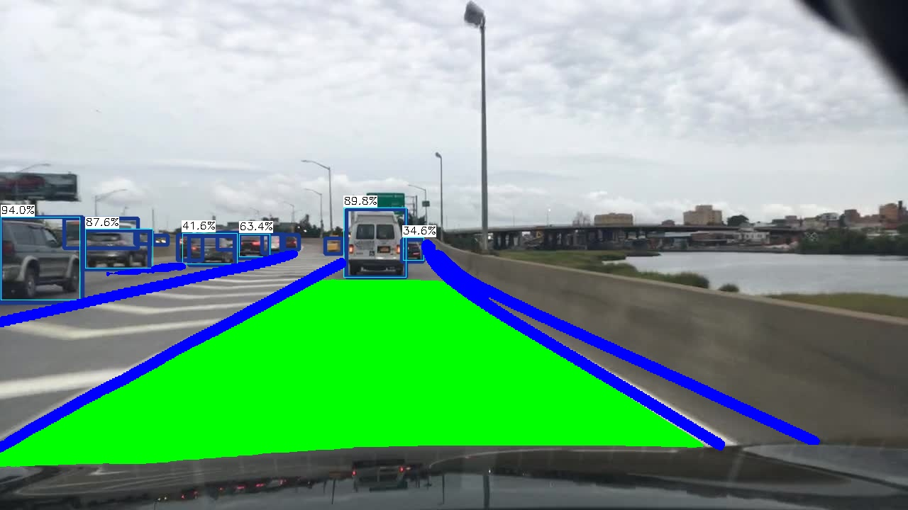
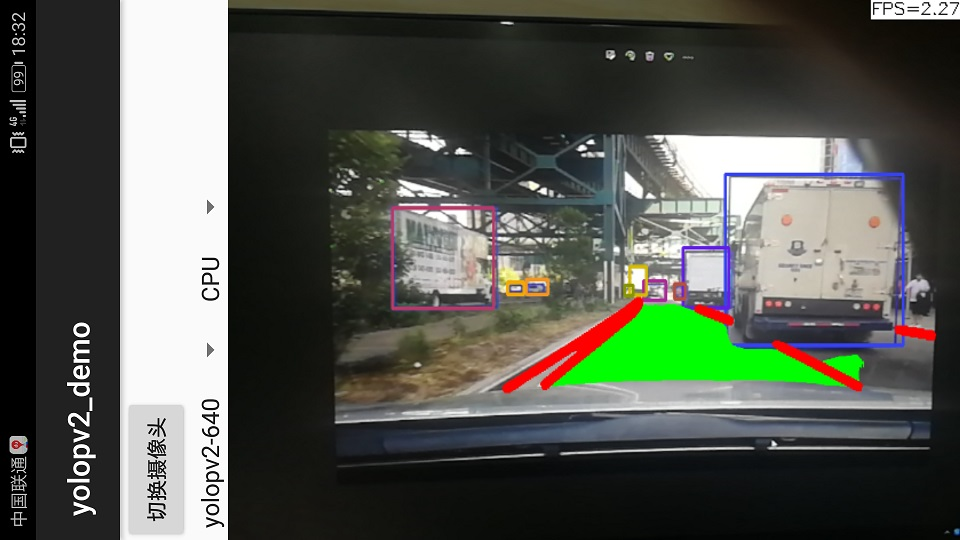

# YOLOPv2-ncnn

```
mkdir build
cd build 
cmake ..
make 
./yolopv2_ncnn ../imgs/veh3.jpg
```

Model files `yolopv2.param` and `yolopv2.bin` must be in `../models` when running from `build`.

## screenshot
  


## reference  
https://github.com/Tencent/ncnn  
https://github.com/CAIC-AD/YOLOPv2
